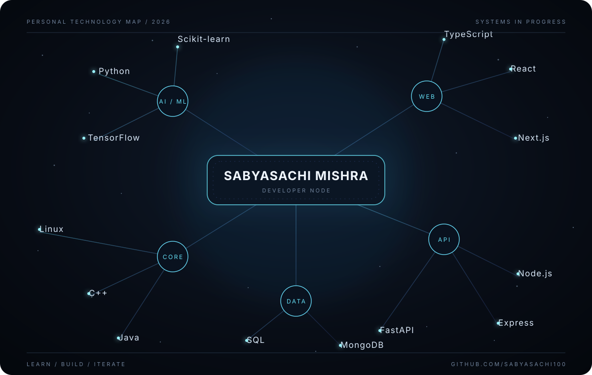

<div align="center">



<br/>

<a href="https://readme-typing-svg.demolab.com">

</a>

<br/>

<a href="https://github.com/Sabyasachi100">

</a>
<a href="YOUR_LINKEDIN_URL">

</a>
<a href="mailto:YOUR_EMAIL">

</a>

</div>

<br/>

<div align="center">

# `01` — ABOUT ME

</div>

```text
Name       : Sabyasachi Mishra
Role       : Computer Science Student
Interests  : AI/ML, Software Engineering, Full-Stack Development
Mindset    : Learn → Build → Experiment → Improve
```

I'm a Computer Science student passionate about software development, artificial intelligence, and building technology that solves real-world problems.

I enjoy experimenting with new technologies, developing projects, understanding how systems work behind the scenes, and continuously improving my engineering skills.

---

<div align="center">

# `02` — CURRENTLY EXPLORING

</div>

- Artificial Intelligence & Machine Learning
- Full-Stack Web Development
- Backend Development & API Design
- Data Structures & Algorithms
- Computer Vision
- Database Systems & System Design

---

<div align="center">

# `03` — FEATURED PROJECTS

</div>

<table>
<tr>
<td width="50%">

### 📈 AI Stock Market Prediction

Machine learning-based stock prediction application exploring historical financial data, sequence modeling, and future price forecasting.

**Tech Stack**

Python · TensorFlow · LSTM · Pandas · Streamlit

[View Repository](https://github.com/Sabyasachi100/AI-Stock-Market-Prediction)

</td>

<td width="50%">

### ⚡ DevFlow

A full-stack productivity and workspace application exploring authentication, database architecture, backend engineering, and collaborative workflows.

**Tech Stack**

Next.js · TypeScript · PostgreSQL · Prisma · Redis

</td>
</tr>

<tr>
<td width="50%">

### 🧠 SoulHeal

A student-focused mental wellness platform designed to provide accessible digital support and meaningful user experiences.

**Tech Stack**

React · Node.js · Express · MongoDB

</td>

<td width="50%">

### 🖐️ GestureX

A computer vision project exploring hand tracking and gesture-based computer interaction.

**Tech Stack**

Python · OpenCV · MediaPipe

</td>
</tr>
</table>

---

<div align="center">

# `04` — TECH STACK

</div>

<div align="center">

### LANGUAGES


### AI / MACHINE LEARNING


### FRONTEND & BACKEND


### DATABASES


### TOOLS & ENVIRONMENT


</div>

---

<div align="center">

# `05` — GITHUB ANALYTICS

<br/>


<br/><br/>


</div>

---

<div align="center">

# `06` — CONTRIBUTION MATRIX


</div>

---

<div align="center">

# `07` — CONNECT

### Let's build something interesting.

<a href="https://github.com/Sabyasachi100">GitHub</a> •
<a href="https://www.linkedin.com/in/sabyasachi-mishra-26b29833b">LinkedIn</a> •
<a href="mailto:sabyasachimishra2510@gmail.com">Email</a>

<br/><br/>


<sub>Curiosity drives the code.</sub>

</div>
